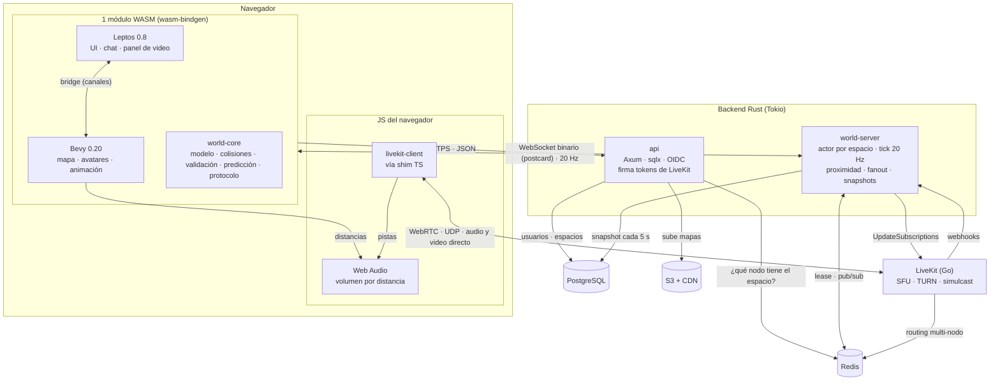

# Rust-first Virtual Workspace: propuesta de arquitectura

> Versión 2 · 2 de noviembre de 2026
> Versión visual: https://claude.ai/artifact/SoAZ58uMxYtATxYc67H6N4
> Plan de aprendizaje y ejecución: [`PLAN.md`](../PLAN.md)

## Resumen

Una oficina virtual 2D con video por proximidad, construida con Rust de punta a punta:

- **Navegador:** un solo módulo WASM con Leptos (UI), Bevy (mundo 2D) y `world-core`, un núcleo de simulación que es el mismo crate que usa el servidor.
- **Backend Rust:** dos binarios. `api` (Axum + sqlx) y `world-server` (un actor Tokio por espacio).
- **Audio y video:** LiveKit self-hosted, conectado directo al navegador. El backend decide quién recibe a quién.
- **Datos:** PostgreSQL, Redis y S3 + CDN.

El objetivo doble es tener un producto en producción y la evidencia para presentarse como desarrollador Rust senior.

---

## 1. Punto de partida: cómo está hecho Gather

Análisis de sus bundles públicos (`app.gather.town` y `app.v2.gather.town`) y cabeceras HTTP, hecho el 2 de noviembre de 2026.

| Capa | Lo que usa Gather |
|---|---|
| Landing (www) | Framer |
| UI | React 18.3.1 (v1) y React 19.2.0 (v2) |
| Mundo 2D | Phaser 3.80.1 (WebGL con fallback a Canvas) |
| Estado | Redux (v1), MobX (v2) |
| Bundler | webpack (v1), Rspack (v2) |
| Tiempo real | WebSocket a `game-router` / `router`, con protobuf (v1) y MessagePack (v2) |
| Audio y video | WebRTC con mediasoup-client y su propio SFU (fork `@gathertown/mediasoup`); LiveKit como estrategia alternativa (`AvStrategy`: `livekit`, `livekitselfhost`) |
| Extras de audio | Krisp (WASM) para ruido, AssemblyAI para transcripción (v2) |
| Infra | S3 + CloudFront para la SPA, Cloudflare delante de las APIs, Firebase Auth |
| Observabilidad | New Relic, Sentry, Grafana Faro, OpenTelemetry |
| Escritorio | Electron |
| Backend | TypeScript en frontend y backend, según sus ofertas de empleo |

Conclusión: Gather es un producto TypeScript con medios en C++ (mediasoup). La propuesta mantiene la forma del sistema (cliente con motor 2D, servidor de mundo con estado, SFU aparte) y cambia el lenguaje y varias decisiones.

---

## 2. Producto y posicionamiento

- **Producto propio en la categoría "oficina virtual"**, no un clon: nombre, arte y UX propios. Para empezar sirven los assets CC0 de Kenney.
- **Nicho sugerido:** oficina virtual self-hosted o con residencia de datos para empresas, bancos o universidades de LatAm. Rust ayuda: binarios pequeños, poca RAM y despliegue simple.
- **Competidor open source a estudiar:** WorkAdventure (TypeScript).

---

## 3. Arquitectura



<details>
<summary>Versión ASCII (para terminal)</summary>

```
Navegador ─────────────────────────────────────────────────────────────
 [1 módulo WASM]  Leptos (UI) ⇄ bridge ⇄ Bevy (mundo)      [JS] Web Audio
                  world-core (mismo crate que el servidor)      livekit-client
      │ HTTPS · JSON          │ WebSocket binario · 20 Hz         │ WebRTC (directo)
      ▼                       ▼                                   ▼
 api (Axum)              world-server (actor por espacio) ──► LiveKit (Go)
 OIDC · tokens LiveKit   proximidad · fanout · snapshots  ◄── webhooks
      │                       │                                   │
 PostgreSQL · S3+CDN     Redis (leases espacio→nodo, pub/sub) ◄───┘ routing multi-nodo
```
</details>

### Responsabilidades

| Pieza | Hace | No hace |
|---|---|---|
| `world-core` | Modelo del mundo, colisiones, movimiento, validación, proximidad. Compila a nativo y a `wasm32`. | Red, render, I/O. |
| Leptos | Login, chat, paneles, video, ajustes. Monta el `<canvas>` de Bevy. | Lógica del mundo. |
| Bevy | Dibujar mapa y avatares, cámara, input, animación, interpolación. | Decidir si un movimiento es válido. |
| `api` | Login OIDC, espacios, invitaciones, mapas en S3, tokens de LiveKit, decir a qué nodo conectarse. | Estado en tiempo real. |
| `world-server` | Un actor por espacio: aplica inputs, valida, calcula proximidad, reparte deltas, guarda snapshots, controla suscripciones de LiveKit. | Medios. |
| LiveKit | SFU, TURN, simulcast/dynacast, señalización WebRTC. | Decidir quién está cerca de quién. |
| Redis | Leases "espacio → nodo", pub/sub entre nodos, caché. También lo usa LiveKit. | Datos durables. |
| PostgreSQL | Usuarios, espacios, configuración, snapshots. | Tráfico por tick. |

---

## 4. Cambios respecto a la primera propuesta

| # | Antes | Ahora | Por qué |
|---|---|---|---|
| 1 | Rust + Macroquad para el mundo | Bevy 0.20 en el mismo módulo que Leptos | Macroquad no usa wasm-bindgen: trae su propio loader JS (`mq_js_bundle.js`) y WebGL 1. Junto a Leptos quedarían dos módulos WASM y el núcleo compilado dos veces. |
| 2 | Colisiones en el renderer | Colisiones en `world-core` | Cliente y servidor deben calcular exactamente lo mismo o la predicción se desincroniza. |
| 3 | Room Engine y Realtime Service separados | Un solo `world-server` con un actor por espacio | Cada tick mueve, calcula proximidad y reparte. Separarlo agrega un salto de red en la ruta más caliente. |
| 4 | WebRTC pasando por el backend | Navegador ↔ LiveKit directo, con `livekit-client` (JS) | El media no toca el backend. No todo el cliente es WASM. |
| 5 | Media Control hace la señalización | `world-server` maneja suscripciones y webhooks; `api` firma tokens | LiveKit ya hace la señalización. El trabajo propio es decidir quién recibe a quién. |
| 6 | NATS / Redis | Solo Redis | LiveKit necesita Redis en multi-nodo. Una pieza menos que operar. |
| 7 | No estaban | S3 + CDN, OIDC, TURN de LiveKit, OpenTelemetry | Necesarias para producción. |

---

## 5. Decisiones clave

### 5.1 Bevy 0.20 para el mundo 2D

- Usa wasm-bindgen como Leptos, así que conviven en un solo módulo con una sola copia de `world-core`.
- Trae cámara, input, animación de sprites, carga de assets y tilemaps (`bevy_ecs_tilemap` 0.20).
- Corre nativo: el mundo se prueba con `cargo run` sin compilar a WASM en cada cambio.
- En web se empieza con el backend WebGL2. WebGPU puede venir después.

**Integración con Leptos:** `leptos-bevy-canvas` 0.6.0 (junio 2026) depende de `bevy ^0.19`. Decisión: bridge propio (`client-bridge`), un crate pequeño con dos canales (órdenes UI → mundo, eventos mundo → UI) guardados como `Resource` en Bevy. `leptos-bevy-canvas` queda como código de referencia.

**Tamaño y versiones:**
- `default-features = false` y solo features 2D.
- Perfil release WASM con `lto`, `codegen-units = 1`, `opt-level = "z"`; luego `wasm-opt -Oz` y brotli en el CDN.
- Límite de tamaño del `.wasm` en CI.
- Bevy cambia API en cada versión (0.19 en junio, 0.20 en octubre de 2026): versión fija, una actualización por release en rama aparte, Bevy encapsulado en `client-world`.

**Descartadas:** Macroquad (sin wasm-bindgen, WebGL 1) y Canvas 2D vía `web-sys` (viable y liviano, pero habría que escribir cámara, animación e input, y no corre nativo).

### 5.2 LiveKit en vez de mediasoup

| | mediasoup (crate Rust) | LiveKit self-hosted |
|---|---|---|
| Qué es | Librería: salas, señalización y escalado los construyes tú | Servidor completo (Go, Apache-2.0, v1.13.11) |
| Multi-nodo | Propio (`pipeToRouter` entre hosts) | Incluido, con Redis |
| TURN | Aparte (coturn) | Integrado |
| Calidad adaptativa | Simulcast, lógica propia | Simulcast, SVC, dynacast, adaptive stream |
| Grabación | Propia | Egress / ingress |
| Móvil | Limitado | SDKs oficiales iOS, Android, Flutter |
| Rust | Control del SFU en proceso | `livekit-api` 0.10 (tokens, RoomService, webhooks) y `livekit` 0.10 (SDK nativo) |
| Esfuerzo estimado | 6–8 semanas | 3–4 semanas |

En ambos casos Rust solo controla un SFU escrito en otro lenguaje. Lo que diferencia el proyecto está en `world-core`, `world-server` y el cliente WASM, así que LiveKit libera tiempo para eso.

- El crate `livekit` (Rust) usa libwebrtc nativo y **no compila a WASM**. En el navegador se usa `livekit-client` (JS) con un shim TS. El crate Rust sirve para bots de carga y agentes (por ejemplo, transcripción).
- mediasoup sigue siendo la opción si se quiere todo el stack en Rust, control de suscripciones por diseño del servidor, o aprender un SFU por dentro (y luego uno propio con `str0m`).

### 5.3 Un solo `world-server` con actores

- Cada espacio es una tarea Tokio dueña de su estado, que recibe comandos por `mpsc` y avanza 20 ticks por segundo. Sin `Arc<Mutex<_>>` en la ruta caliente.
- Un espacio vive en un solo nodo. El registro "espacio → nodo" es un lease en Redis (`SET NX PX`, renovado por el actor).
- Si un nodo cae, el lease expira y otro nodo rehidrata el espacio desde el último snapshot en Postgres.
- Se divide en servicios solo cuando haya datos que lo justifiquen (monolito modular primero).

### 5.4 Protocolo y transporte

- Tipos de mensaje compartidos en el crate `protocol`, serializados con `serde` + `postcard`, con versión de protocolo explícita.
- WebSocket binario primero. WebTransport (`wtransport`) después, para datagramas no fiables en posiciones, con fallback a WebSocket.
- La API REST usa JSON con contrato OpenAPI generado por `utoipa`.

### 5.5 Movimiento por tiles

- Las posiciones son enteros de tile, como en Gather. La interpolación suave es solo visual, en Bevy.
- Ventaja: simulación determinista y simple de validar en el servidor, sin problemas de punto flotante entre plataformas.

### 5.6 Solo Redis para coordinación

- Leases, pub/sub entre nodos y caché.
- NATS JetStream solo si más adelante se necesita durabilidad de eventos.
- A escala, instancia de Redis separada para LiveKit.

---

## 6. El camino de un movimiento

1. Al entrar, la `api` valida el JWT, lee en Redis qué nodo tiene el espacio y devuelve la URL de ese nodo junto con un token de LiveKit.
2. El cliente abre el WebSocket directo a ese nodo. Cada input lleva un número de secuencia y `world-core` lo aplica en el cliente al instante (predicción).
3. El actor del espacio aplica los inputs en el siguiente tick (20 por segundo) con el mismo `world-core` y rechaza los movimientos inválidos.
4. Con una grilla espacial calcula quién está cerca de quién y envía a cada cliente solo los cambios de su entorno, junto con el último input confirmado.
5. El cliente reconcilia: descarta los inputs confirmados y vuelve a simular los pendientes sobre el estado del servidor.
6. Si cambió el grupo de vecinos de alguien, `world-server` llama a `UpdateSubscriptions` en LiveKit, con histéresis (entrar a 5 tiles, salir a 7) para no suscribir y desuscribir en cada paso.
7. LiveKit envía audio y video directo al navegador. Bevy pasa las distancias a Web Audio y el volumen baja con la distancia.
8. Cada 5 segundos el actor guarda un snapshot en Postgres y renueva su lease en Redis. Si el nodo cae, otro nodo carga el espacio desde el último snapshot.

## 7. Proximidad y seguridad del media

- **Zonas privadas** (salas de reunión): cada una es una room de LiveKit separada. La `api` solo entrega el token si `world-server` confirma que el avatar está dentro. Aislamiento real aunque el cliente esté modificado.
- **Zonas abiertas:** una room por zona con `autoSubscribe: false`; el servidor maneja suscripciones con `UpdateSubscriptions` (requiere `roomAdmin`).
- **Pendiente de verificar (fase 5):** si un token con `canSubscribe: false` bloquea las suscripciones del cliente y aun así permite `UpdateSubscriptions` desde el servidor. No está documentado.

---

## 8. Stack y versiones

Verificadas en crates.io y GitHub el 2 de noviembre de 2026.

| Pieza | Elección | Versión |
|---|---|---|
| Toolchain | Rust stable | 1.99.0 |
| UI | Leptos (CSR) | 0.8.23 |
| Mundo 2D | Bevy + bevy_ecs_tilemap, mapas Tiled | 0.20.1 · 0.20.0 |
| Build WASM | wasm-bindgen + Trunk | 0.2.130 · 0.22.1 |
| Protocolo | serde + postcard | postcard 1.1.3 |
| Runtime | Tokio | 1.54.1 |
| API | Axum + sqlx + utoipa | 0.8.9 · 0.9.0 · 6.0.0 |
| Login | Keycloak o Zitadel (OIDC) | – |
| Audio y video | LiveKit server + livekit-api + livekit-client (JS) | v1.13.11 · 0.10.0 |
| Datos | PostgreSQL, Redis, S3 + CDN | – |
| Observabilidad | tracing + opentelemetry → Grafana (Tempo, Loki, Prometheus) | 0.33.1 |
| Escritorio | Tauri | 2.12.5 |
| Carga | bots propios (WebSocket + crate livekit) | – |
| Diferenciadores | wasmtime, nnnoiseless, wtransport | 50.0.1 · 0.5.2 · 0.7.2 |

## 9. Estructura del repositorio

```
crates/
  protocol/       mensajes compartidos (serde + postcard)
  world-core/     mapa, colisiones, movimiento, validación, proximidad
  world-server/   actores por espacio, WebSocket, control de LiveKit
  api/            Axum + sqlx, OIDC, tokens de LiveKit
  client/         Leptos y punto de entrada del módulo WASM
  client-world/   Bevy: render del mundo
  client-bridge/  canales entre Leptos y Bevy
  bots/           enjambre de bots para pruebas de carga
  desktop/        Tauri
xtask/            build WASM, límite de tamaño, tareas de CI
docs/
  adr/            decisiones de arquitectura
  bitacora/       un archivo por lección: tus notas y mi revisión
```

## 10. Infraestructura y operación

- **Imágenes:** multi-stage con `cargo-chef`, binarios estáticos (musl) o distroless.
- **Despliegue:** Kubernetes + Helm/ArgoCD, infraestructura con OpenTofu. LiveKit en nodos con red de host para sus puertos UDP, y TURN/TLS por 443 para redes corporativas.
- **CI:** `cargo fmt --check`, `cargo clippy -- -D warnings`, `cargo nextest`, `cargo-deny`, build `wasm32` de `world-core`, límite de tamaño del WASM.
- **Observabilidad:** `tracing` + OpenTelemetry hacia Grafana. SLOs iniciales: p99 del tick, éxito al entrar a un espacio.
- **Costos:** el ancho de banda del video domina. LiveKit en un proveedor con tráfico incluido, no en egress de AWS.

## 11. Fases

| Fase | Entregable |
|---|---|
| 0. Preparación | Workspace, toolchain, CI con gates de calidad |
| 1. world-core | Simulación determinista, probada y medida, que compila a WASM |
| 2. world-server | Actor por espacio, WebSocket, bots de carga, primer despliegue |
| 3. Cliente WASM | Leptos + Bevy + bridge, predicción y reconciliación |
| 4. API y datos | Axum + sqlx, OIDC, espacios, mapas, directorio de nodos |
| 5. Audio y video | LiveKit, suscripciones por proximidad, zonas privadas |
| 6. Producción | Kubernetes, observabilidad, resiliencia, seguridad |
| 7. Diferenciadores | Plugins WASM, supresión de ruido, WebTransport, Tauri |

Detalle por lección, con objetivos funcionales y no funcionales: [`PLAN.md`](../PLAN.md). Con el ciclo de aprendizaje, el total es de unos 7 meses a tiempo parcial (10–15 h por semana) hasta tener usuarios piloto.

## 12. Riesgos

| Riesgo | Mitigación |
|---|---|
| Bevy rompe su API en cada versión | Versión fija, una actualización por release, Bevy encapsulado en `client-world`, bridge propio |
| El WASM crece sin control | Límite de tamaño en CI desde la fase 3 |
| Un cliente modificado se suscribe por su cuenta en zonas abiertas | Zonas privadas como rooms separadas; probar `canSubscribe: false` en la fase 5 |
| Tauri en Linux: WebKitGTK tiene WebRTC limitado | Validar antes de prometer la app de escritorio en Linux |
| Costo de ancho de banda | Proveedor con tráfico incluido para LiveKit |
| Alcance demasiado grande para una persona | Fases 0–6 son el MVP; la fase 7 solo con usuarios reales |

## 13. Cómo presentarlo en tu perfil

- Tu seniority en Java, DevOps y diseño de sistemas es real y se transfiere. El proyecto es la prueba de Rust.
- Preséntalo como "producto propio en producción con Rust", con:
  - README con números medidos (usuarios por nodo, p99 del tick, bytes por cliente).
  - ADRs en `docs/adr/`.
  - Una serie de posts, uno por fase.
  - Si se puede, un PR aceptado en un crate que uses (Bevy, Leptos, livekit rust-sdks).
- En una entrevista te van a pedir que defiendas decisiones como "por qué actores y no `Arc<Mutex>`". El plan incluye esas preguntas al cierre de cada lección.

## 14. Fuentes

- Bundles públicos de `app.gather.town` y `app.v2.gather.town`, cabeceras HTTP de `www.gather.town` (2 nov 2026).
- [@gathertown/mediasoup en npm](https://socket.dev/npm/package/@gathertown/mediasoup)
- [Gather: Staff Software Engineer, Infrastructure and Networking](https://jobs.orbit.mit.edu/companies/gather-2-674309dd-fe8e-47c7-8df5-bcd9b2a88b57/jobs/32397593-staff-software-engineer-infrastructure-and-networking)
- [Gather: Senior Software Engineer, Performance Systems](https://www.indexventures.com/startup-jobs/gather/senior-software-engineer-performance-systems/)
- [LiveKit RoomService API (UpdateSubscriptions)](https://docs.livekit.io/reference/other/roomservice-api/)
- README de [macroquad](https://github.com/not-fl3/macroquad) y [miniquad](https://github.com/not-fl3/miniquad)
- crates.io: dependencias de `leptos-bevy-canvas` 0.6.0 y `bevy_ecs_tilemap` 0.20.0
